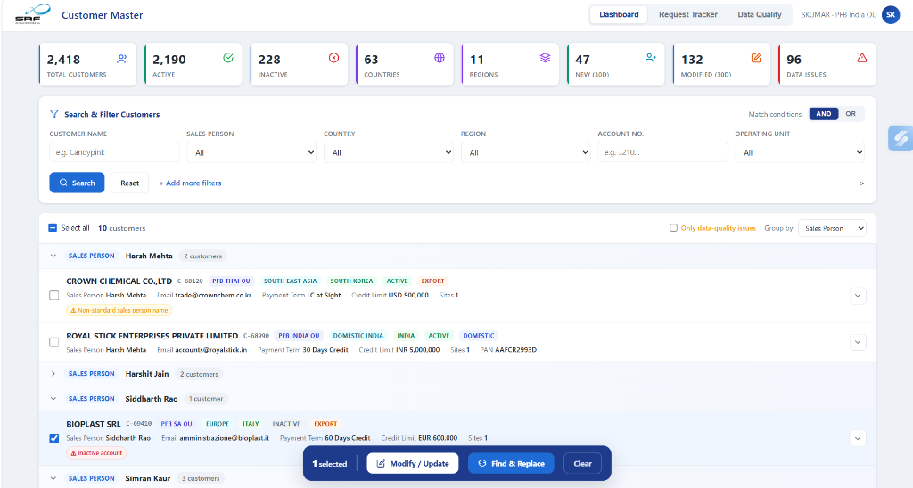
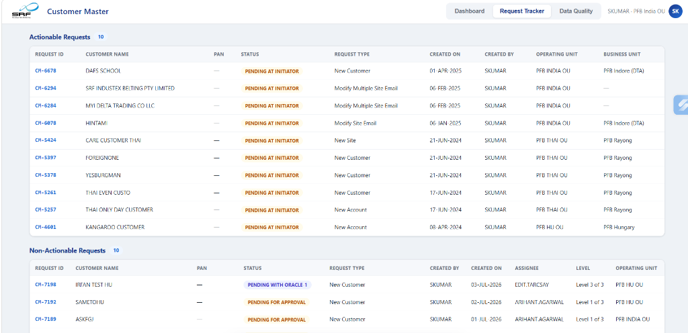

# 🏢 SRF Customer Master — UI Console

Customer Master Data Management (MDM) portal developed for **SRF Limited** (Packaging Films Business). It provides a unified console for single & bulk customer updates, hierarchical account tracking, data quality checks, and workflow approval integration with **Oracle E-Business Suite (EBS R12)**.

---

## 📸 Screenshots

### 1. Dashboard (Single & Bulk Update Console)


* **Real-Time KPI Ribbon**: Instant counters for Total Customers (2,418), Active/Inactive status, Global Footprint (Countries & Regions), and Data Quality Issues.
* **Smart Filter Panel**: Fast search by Customer Name, Sales Person, Operating Unit (OU), Account No., and Region with AND/OR condition toggles.
* **Hierarchical Grid**: Multi-level customer tree view covering Party ➔ Accounts ➔ Sites (Bill-To / Ship-To) ➔ Contacts.
* **Bulk Action Bar**: Sticky floating toolbar to trigger batch updates (*Modify / Update*, *Find & Replace*) across selected records.

---

### 2. Request Tracker (Workflow & Approvals)


* **Actionable Requests**: Requests requiring immediate action from the initiator (`PENDING AT INITIATOR`) across Operating Units (PFB India, PFB Thai, PFB Hungary).
* **Non-Actionable Requests**: In-flight requests currently in multi-tier approval stages (`Level 1 of 3`, `Level 3 of 3`) or automated ERP sync (`PENDING WITH ORACLE 1`).
* **Drafts**: Centralized repository of saved, unsubmitted requests.

---

## ✨ Key Features

- **Multi-OU Governance**: Supports global operations across `PFB INDIA OU`, `PFB THAI OU`, `PFB HU OU`, and `PFB SA OU`.
- **Pre-ERP Data Quality Checks**: Proactively flags missing regions, inactive sales reps, unresolved payment terms, and email mismatches across sites before pushing to Oracle.
- **Bulk & Single Operations**: Batch reassign sales representatives, update billing email addresses, or execute find-and-replace across hundreds of customer sites.
- **Oracle EBS R12 & BPM Alignment**: Direct mapping with Oracle Trading Community Architecture (TCA tables: `HZ_PARTIES`, `HZ_CUST_ACCOUNTS`, `HZ_CUST_SITE_USES_ALL`).

---

## 🚀 How to Run

Zero build tools or dependencies required.

1. **Direct Launch**: Double-click [`index.html`](index.html) to open directly in any modern browser.
2. **Local HTTP Server** (Optional):
   ```bash
   python -m http.server 8080
   ```
   Open `http://localhost:8080/index.html` in your browser.