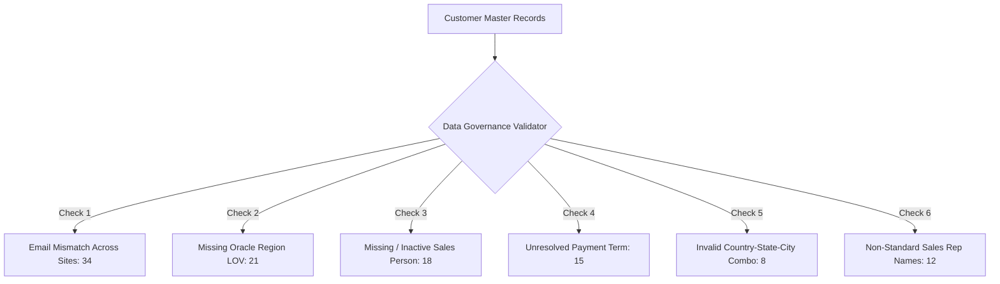
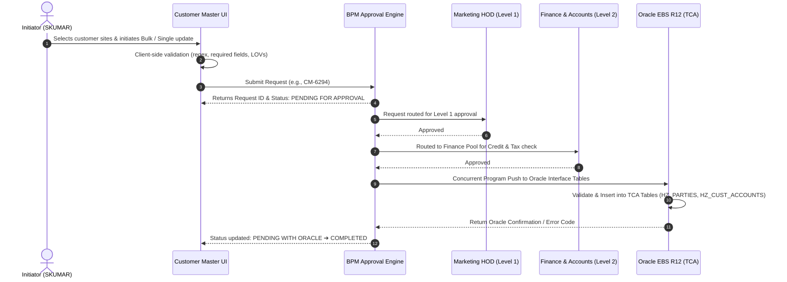

# 🏢 SRF Customer Master — Master Data Management (MDM) Console

[-0ea5e9.svg)](#technology-stack)
[](#integration-architecture)
[](#3-data-quality--governance-engine)
[](#)

Enterprise-grade **Customer Master Data Management (MDM) Portal** developed for **SRF Limited** (Packaging Films Business - PFB). The console provides a centralized, unified interface for customer onboarding, multi-tier hierarchical account management, bulk data maintenance, automated data-hygiene validation, and end-to-end approval workflows bridging commercial teams with **Oracle E-Business Suite (EBS R12)**.

---

## 📑 Table of Contents
- [Executive Overview](#-executive-overview)
- [Key Modules & UI Walkthrough](#-key-modules--ui-walkthrough)
  - [1. Dashboard — Single & Bulk Customer Console](#1-dashboard--single--bulk-customer-console)
  - [2. Request Tracker — Workflow & Approval Lifecycle](#2-request-tracker--workflow--approval-lifecycle)
  - [3. Data Quality & Governance Engine](#3-data-quality--governance-engine)
- [Workflow & Integration Architecture](#-workflow--integration-architecture)
- [Oracle TCA Data Mapping](#-oracle-tca-data-mapping)
- [Technology Stack](#-technology-stack)
- [Getting Started & Local Execution](#-getting-started--local-execution)
- [Deployment & Extensibility](#-deployment--extensibility)

---

## 🎯 Executive Overview

In large multi-national manufacturing environments like SRF Limited, customer master data is distributed across diverse global **Operating Units (OUs)** — including:
* **PFB India OU** (Indore DTA, Kashipur, etc.)
* **PFB Thai OU** (Rayong)
* **PFB HU OU** (Hungary)
* **PFB SA OU** (South Africa / Durban)

Discrepancies in billing addresses, inconsistent sales rep tagging, mismatched multi-site emails, and missing tax/region codes lead to order booking halts, invoicing delays, and shipping failures in Oracle EBS.

This application acts as a **smart governance layer** between business initiators (Sales/Commercial), approval committees (HOD Marketing, Finance & Accounts), and the downstream Oracle ERP system.

---

## 🖥️ Key Modules & UI Walkthrough

The application is structured into three dedicated views accessible via the global navigation header:

```
SRF Customer Master Portal
├── 📊 Dashboard (Search, KPI Analytics, Hierarchical Viewer & Bulk Actions)
├── 📋 Request Tracker (Actionable vs. Non-Actionable Workflow Approvals)
└── 🛡️ Data Quality (Real-Time Governance & Validation Discrepancy Cards)
```

---

### 1. Dashboard — Single & Bulk Customer Console

Designed for rapid customer lookup, deep hierarchical exploration, and high-volume mass updates.

#### 📈 Real-Time KPI Metric Strip
At the top of the dashboard, eight responsive KPI counters provide immediate operational visibility:

| Metric | Count | Description | Status Code |
| :--- | :---: | :--- | :--- |
| **Total Customers** | **2,418** | Total active & inactive customer records in master | Primary Blue |
| **Active** | **2,190** | Operational customers eligible for transaction booking | Active Green |
| **Inactive** | **228** | Blocked or dormant customer entities | Neutral Slate |
| **Countries** | **63** | Global geographic distribution | Accent Violet |
| **Regions** | **11** | Sales/Trading regions (Domestic, EMEA, Americas, APAC) | Accent Purple |
| **New (30d)** | **47** | Newly onboarded customers within the last 30 days | Growth Cyan |
| **Modified (30d)** | **132** | Customers with modified accounts, sites, or commercial terms | Warning Amber |
| **Data Issues** | **96** | Records flagged with pre-ERP validation discrepancies | Alert Red |

#### 🔎 Multi-Criteria Search & Filter Engine
Allows users to slice customer datasets through exact and partial criteria:
* **Customer Name**: Instant substring search (e.g., *Candypink*, *SRF Industex*).
* **Sales Person**: Dynamic dropdown populated from Oracle active sales representative LOV.
* **Country & Region**: Geographical scoping.
* **Account No.**: Direct query by Oracle Customer Account Number.
* **Operating Unit**: Filter by `PFB INDIA OU`, `PFB THAI OU`, `PFB HU OU`, `PFB SA OU`.
* **Match Logic Toggle**: Switch between **AND** (strict) and **OR** (broad) condition evaluation.
* **Data Quality Shortcut**: Toggle to instantly isolate only the 96 customers having data discrepancies.

#### 🌳 4-Tier Hierarchical Data Table
Visualizes the Oracle Trading Community Architecture (TCA) structure:
1. **Party Level (Customer Group)**: Customer Name, Cust Code (`C-XXXXX`), Global PAN, Tax ID, Status badge (`Active` / `Inactive`), Trade classification (`Export` / `Domestic`).
2. **Account Level**: Account Number (`330120`), Account Name, Account Currency (`USD`, `EUR`, `INR`, `ZAR`), Credit Limit.
3. **Site Level (Addresses)**: Bill-to (`BILL_TO`) and Ship-to (`SHIP_TO`) sites, Site Number (`S-XXXXX`), Business Unit, City, Postal Code.
4. **Contact & Commercial Level**: Multi-site Billing Emails, Assigned Sales Person, Assigned Payment Term (`Advance`, `LC at Sight`, `30/60/90 Days Credit`).

#### ⚡ Sticky Bulk Action Bar
When users select one or multiple customer records via checkboxes:
* **Counter Badge**: Displays exact count of selected customer records.
* **Modify / Update**: Guided multi-step modal to perform bulk attribute reassignments (e.g., mass reassigning all sites of a departed sales rep to a new owner, or updating credit payment terms across multiple sites).
* **Find & Replace**: Regex and text replacement tool to mass-correct email domains or address typos across hundreds of sites simultaneously.
* **Clear**: Reset active selection.

---

### 2. Request Tracker — Workflow & Approval Lifecycle

The **Request Tracker** provides complete visibility into BPM approval pipelines, differentiating what requires immediate user action versus what is waiting on others.

#### 🔴 Actionable Requests (Requires Initiator Action)
Lists pending requests where the current user (`SKUMAR · PFB India OU`) must respond, furnish missing documents, or rework submission details.

| Request ID | Customer Name | PAN | Status | Request Type | Created On | Created By | Operating Unit | Business Unit |
| :--- | :--- | :---: | :---: | :--- | :---: | :---: | :--- | :--- |
| **CM-6678** | DAFS SCHOOL | — | <mark>PENDING AT INITIATOR</mark> | New Customer | 01-APR-2025 | SKUMAR | PFB INDIA OU | PFB Indore (DTA) |
| **CM-6294** | SRF INDUSTEX BELTING PTY LIMITED | — | <mark>PENDING AT INITIATOR</mark> | Modify Multiple Site Email | 06-FEB-2025 | SKUMAR | PFB INDIA OU | — |
| **CM-6284** | MYI DELTA TRADING CO LLC | — | <mark>PENDING AT INITIATOR</mark> | Modify Multiple Site Email | 06-FEB-2025 | SKUMAR | PFB INDIA OU | — |
| **CM-6078** | HINTAMI | — | <mark>PENDING AT INITIATOR</mark> | Modify Site Email | 06-JAN-2025 | SKUMAR | PFB INDIA OU | PFB Indore (DTA) |
| **CM-5424** | CARE CUSTOMER THAI | — | <mark>PENDING AT INITIATOR</mark> | New Site | 21-JUN-2024 | SKUMAR | PFB THAI OU | PFB Rayong |
| **CM-5397** | FOREIGNONE | — | <mark>PENDING AT INITIATOR</mark> | New Customer | 21-JUN-2024 | SKUMAR | PFB THAI OU | PFB Rayong |
| **CM-5378** | YESBURGMAN | — | <mark>PENDING AT INITIATOR</mark> | New Customer | 21-JUN-2024 | SKUMAR | PFB THAI OU | PFB Rayong |
| **CM-5261** | THAI EVEN CUSTO | — | <mark>PENDING AT INITIATOR</mark> | New Customer | 17-JUN-2024 | SKUMAR | PFB THAI OU | PFB Rayong |
| **CM-5257** | THAI ONLY DAY CUSTOMER | — | <mark>PENDING AT INITIATOR</mark> | New Account | 17-JUN-2024 | SKUMAR | PFB THAI OU | PFB Rayong |
| **CM-4601** | KANGAROO CUSTOMER | — | <mark>PENDING AT INITIATOR</mark> | New Account | 08-APR-2024 | SKUMAR | PFB HU OU | PFB Hungary |

#### 🟡 Non-Actionable Requests (In-Flight Approvals)
Tracks requests currently progressing through higher management approval tiers or Oracle automated synchronization.

| Request ID | Customer Name | Status | Request Type | Created By | Created On | Assignee | Level | Operating Unit |
| :--- | :--- | :---: | :--- | :---: | :---: | :--- | :---: | :--- |
| **CM-7198** | IRFAN TEST HU | `PENDING WITH ORACLE 1` | New Customer | SKUMAR | 03-JUL-2026 | EDIT.TARCSAY | Level 3 of 3 | PFB HU OU |
| **CM-7192** | SAMETOHU | `PENDING FOR APPROVAL` | New Customer | SKUMAR | 02-JUL-2026 | ARIHANT.AGARWAL | Level 1 of 3 | PFB HU OU |
| **CM-7189** | ASKFGJ | `PENDING FOR APPROVAL` | New Customer | SKUMAR | 01-JUL-2026 | ARIHANT.AGARWAL | Level 1 of 3 | PFB INDIA OU |
| **CM-7181** | VEGA MUSIC-1 | `PENDING FOR APPROVAL` | New Customer | SKUMAR | 30-JUN-2026 | VIKAS | Level 1 of 3 | PFB SA OU |
| **CM-7177** | BIOPLAST SRL | `PENDING WITH ORACLE 1` | New Site | SKUMAR | 25-JUN-2026 | BARUN.MAITY | Level 4 of 4 | PFB SA OU |
| **CM-7176** | SRF INDUSTEX BELTING | `PENDING AT FINANCE POOL` | Modify Site Email | SKUMAR | 11-JUN-2026 | FINANCE | Level 2 of 2 | PFB INDIA OU |

#### 📝 Drafts Section
Stores unsaved or partially drafted customer requests (e.g., `CM-7201`, `CM-7191`, `CM-7188`) to prevent data loss before formal submission.

---

### 3. Data Quality & Governance Engine

The **Data Quality** module proactively diagnoses master records against business validation rules and Oracle EBS database constraints:



1. 🔴 **Email mismatch across sites (34 records)**: Bill-to and ship-to sites having conflicting customer email addresses that risk sending invoices to wrong recipients.
2. 🟡 **Missing Region (21 records)**: Customer addresses lacking a recognized Oracle Region code, blocking tax classification.
3. 🟡 **Missing / Inactive Sales Person (18 records)**: Primary sales rep is either unassigned or terminated, preventing sales order booking.
4. 🟡 **Missing Payment Term (15 records)**: Order management cannot determine credit terms for invoicing.
5. 🔴 **Invalid Country-State-City-Region (8 records)**: Combinations that fail Oracle EBS standard address validation APIs.
6. 🟣 **Non-standard Sales Person names (12 records)**: Variant spellings (e.g., *"Vikas"*, *"V. Pansari"*, *"Vikas Pansari"*) consolidated into single standard LOV.

---

## 🔄 Workflow & Integration Architecture

The following diagram illustrates how user requests move from initiation to Oracle E-Business Suite database tables:



---

## 🗄️ Oracle TCA Data Mapping

The console's object schema is directly aligned with Oracle's **Trading Community Architecture (TCA)** model:

| UI Attribute | Oracle EBS Database Table | Column Name | Description |
| :--- | :--- | :--- | :--- |
| **Customer Name** | `HZ_PARTIES` | `PARTY_NAME` | Legal commercial name |
| **Customer No.** | `HZ_PARTIES` | `PARTY_NUMBER` | Unique party reference |
| **PAN Number** | `HZ_PARTIES` | `JGZZ_FISCAL_CODE` | Indian Permanent Account Number |
| **Account No.** | `HZ_CUST_ACCOUNTS` | `ACCOUNT_NUMBER` | Billing account number |
| **Credit Limit** | `HZ_CUST_PROFILE_AMTS` | `OVERALL_CREDIT_LIMIT` | Credit threshold limit |
| **Site Use Code** | `HZ_CUST_SITE_USES_ALL` | `SITE_USE_CODE` | `BILL_TO` / `SHIP_TO` |
| **Operating Unit** | `HR_OPERATING_UNITS` | `NAME` / `ORG_ID` | Operating Unit identifier |
| **Sales Person** | `JTF_RS_SALESREPS` | `NAME` / `SALESREP_ID` | Assigned account manager |
| **Payment Term** | `RA_TERMS_TL` | `NAME` / `TERM_ID` | Invoicing credit duration |

---

## 💻 Technology Stack

* **Front-End Architecture**: Pure HTML5, Vanilla JavaScript (ES6+), CSS3 with custom variables.
* **No Heavy Framework Overhead**: Built with zero external build tools (`webpack`, `vite`, `npm`), delivering instant sub-second load times.
* **Component Styling**:
  * Semantic tokens for themes (`--navy: #1e3a8a`, `--blue: #1e6bd6`, `--green: #059669`, `--amber: #f59e0b`, `--red: #dc2626`).
  * Modern card elevation shadows and CSS transitions.
  * Sticky toolbars with backdrop blur.
* **Icons**: Inline scalable SVGs (crisp rendering on high-DPI displays).
* **Cross-Browser Support**: Chrome, Microsoft Edge, Firefox, Safari.

---

## 🚀 Getting Started & Local Execution

Since the project is a lightweight self-contained web application, no compilation or package installation is required:

### Option 1: Direct File Launch
Simply double click [index.html](file:///c:/internship/srf/ui/ui/index.html) in your browser.

### Option 2: Local Python Server
Run a lightweight HTTP server in the project directory:

```bash
# Python 3
python -m http.server 8080
```
Then navigate to: `http://localhost:8080/index.html`

### Option 3: Node.js `serve` / VS Code Live Server
```bash
npx serve .
```

---

## 🔮 Deployment & Extensibility

* **Oracle APEX Integration**: Easily wrapped inside an Oracle Application Express (APEX) iframe or custom region.
* **REST API Connectivity**: The hardcoded `FIELD_META`, `CUSTOMERS`, and `REQ_TRACKER_DATA` arrays can be seamlessly wired to Oracle REST Data Services (ORDS) endpoints or Spring Boot microservices.
* **Role-Based Access Control (RBAC)**: Supports dynamic role rendering (Initiator, HOD Approver, Finance Admin, Oracle Sysadmin).

---

## 📄 License & Attribution

Internal enterprise application proprietary to **SRF Limited** · Packaging Films Business (PFB).  
Developed for Customer Master Data Management and Oracle R12 Integration.